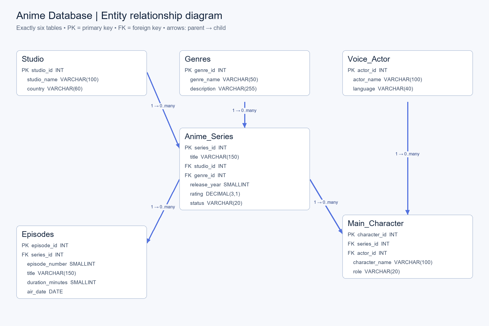
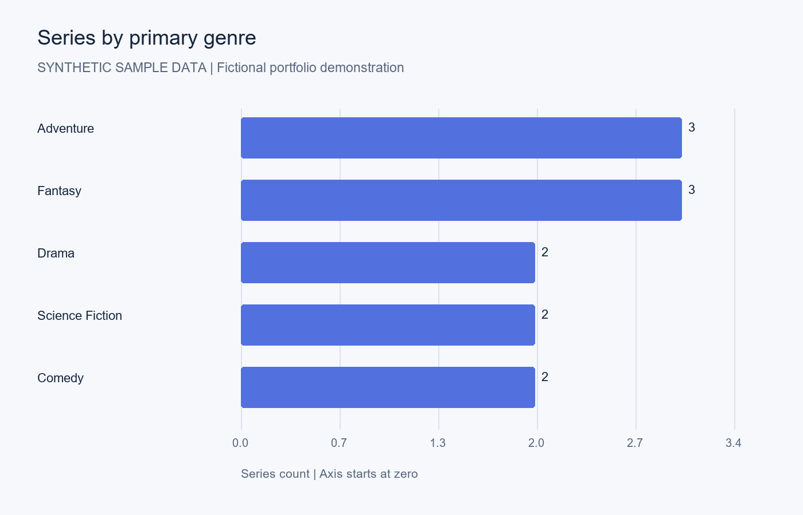
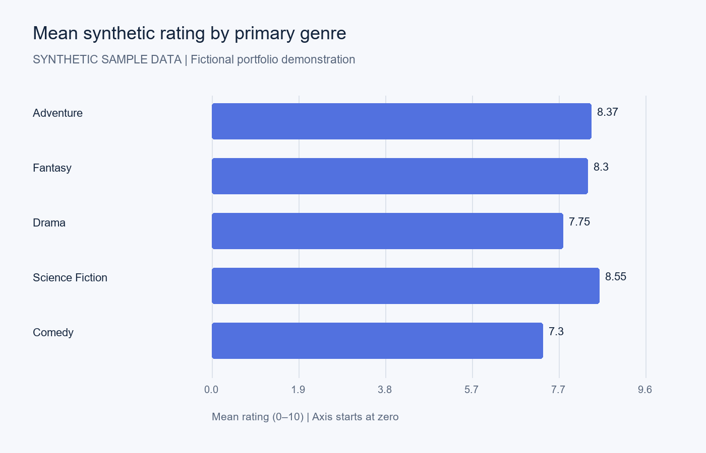

# Anime Database — MySQL Portfolio Project

A relational database portfolio demonstrating schema design, referential integrity, joins, aggregation, subqueries and window functions across six tables. Includes runnable SQL, an ERD, a column-level dictionary, reproducible charts and validation evidence.

**Data provenance:** Every entity, date, score and episode detail is synthetic. No user SQL data was supplied. Charts describe this fictional demonstration dataset only.

## Preview





## Quick start

Prerequisite: MySQL 8.0.16 or newer (8.4 recommended), a MySQL client, and permission to create `anime_portfolio` and its tables. Use an empty demonstration database. Table names are case-sensitive on some platforms; the provided scripts use consistent casing.

From the repository root, start the MySQL command-line client:

```sh
mysql -u root -p
```

At the `mysql>` prompt, run these commands one at a time:

```sql
SOURCE sql/01_schema.sql;
SOURCE sql/02_seed.sql;
SOURCE sql/03_analysis.sql;
SOURCE sql/04_validate.sql;
```

In MySQL Workbench, open and execute the same files in that order. Schema loading does not drop tables. The seed should be loaded once; duplicate IDs cause reruns to fail. If seed execution fails in an interactive session, issue `ROLLBACK;` and resolve the error before retrying. Do not disable foreign-key checks.

Expected counts: **4 studios · 5 genres · 12 series · 128 episodes · 8 actors · 36 characters**. All five orphan counts from `04_validate.sql` must be zero; each actual count must match its expected count. The final analysis query for episode gaps should return zero rows.

## Structure

```text
anime-database/
├── README.md
├── .gitignore
├── .github/workflows/mysql-validation.yml
├── sql/                 # schema, transactional sample seed, 10 analyses, checks
├── data/                # synthetic JSON and six CSV exports
├── docs/                # ERD PNG/Mermaid, dictionary, design and validation
│   └── query_results/   # expected sample results for every analysis query
├── visualizations/      # four labeled PNG charts and their aggregate CSVs
├── scripts/             # chart renderer and MySQL result assertions
└── requirements.txt
```

## Questions answered

- Which primary genres and studios have the most series?
- Which fictional titles have the highest scores, including rankings within genre?
- How many stored episodes and runtime minutes does each series have?
- Which actors appear across multiple series, and who voices each character?
- How does sample release output vary by year?
- Which scores exceed the sample mean, and are any episode numbers missing?

The sample has four adventure/fantasy-focused studios with different output. Genre and studio counts are illustrative, and invented ratings are not evidence of real popularity or quality. Read the result CSVs for the exact outputs.

## Model and tradeoffs

`Studio` and `Genres` each have one-to-many relationships with `Anime_Series`. A series has many `Episodes` and `Main_Character` records, and `Voice_Actor` has many character assignments. To preserve the requested six-table model, each series stores one studio and one primary genre; each character stores one voice actor. Multi-genre, co-production and multilingual cast support would require junction tables. [Design notes](docs/design.md) explain keys, cardinalities and deletion behavior; [data dictionary](docs/data_dictionary.md) lists every column and constraint.

## Reproduce the charts

Python 3.10+ is required only for chart generation, not SQL use:

```sh
python -m pip install -r requirements.txt
python scripts/render_visualizations.py
```

Charts use the included JSON sample and write PNGs plus aggregate CSVs to `visualizations/`. If replacing the data, update SQL, JSON/CSV exports, count assertions and documentation together before regenerating charts. SQL aggregates provide an independent way to reproduce their values.

## Validation and limitations

The seed and analysis queries passed local SQLite-based integrity checks, including rejected invalid inserts/updates. **Actual MySQL execution was not available in the generation environment.** See [validation details](docs/validation.md) and the machine-readable report. The included GitHub Actions workflow executes all SQL on MySQL 8.4 and checks orphans, counts and episode sequence integrity when this repository is pushed; it has not run yet.

## Publish on GitHub

Extract the ZIP and upload the contents of `anime-database/` to the root of a new repository. Keep `.github/` and `.gitignore`, including when using tools that hide dotfiles. Review the Actions run before marking the project as MySQL-tested. Customize this README with your own project narrative and repository link. No credentials are included for a real database; the workflow password is only for its disposable CI service. Choose and add a license before inviting reuse; no license is asserted on your behalf.

## MySQL references

- [Foreign key constraints](https://dev.mysql.com/doc/refman/8.4/en/create-table-foreign-keys.html)
- [CHECK constraints](https://dev.mysql.com/doc/refman/8.4/en/create-table-check-constraints.html)
